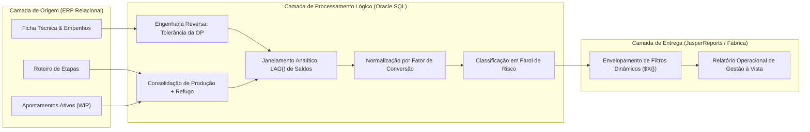

# Detecção em Tempo Real de Perdas Industriais no ERP (WIP Yield Sentinel)

## 📌 O Desafio de Negócio
Nos ambientes industriais de manufatura contínua e acabamento seriado, o controle de perdas tradicionalmente operava sob uma abordagem **post-mortem**: o cálculo da quebra entre etapas só ocorria durante o encerramento da Ordem de Produção (OP), quando blocos anônimos gravavam os refugos tardiamente no banco.

Essa sistemática gerava dois impactos negativos:
1. **Incapacidade de Intervenção em Tempo Hábil:** A supervisão de fábrica só descobria o refugo excessivo dias após o ocorrido, quando o lote já havia passado pelo acabamento e o desperdício físico já era irreversível.
2. **Inflexibilidade de Parâmetros:** A adoção de metas fixas de perda ignorava que produtos de alta complexidade (com múltiplos acabamentos, trocas de bobina e setups) exigem margens técnicas distintas daquelas aplicadas a itens simples.

Fazia-se necessária uma ferramenta operacional integrada ao ERP que permitisse auditar o balanço de massa etapa a etapa **durante o andamento da OP**, alertando os líderes de fábrica imediatamente após cada apontamento de máquina.

## 🎯 O Objetivo
- **Auditoria Ativa de Chão de Fábrica:** Detectar a "perda oculta" (diferença entre o material liberado pela etapa anterior e o somatório apontado na etapa atual) sem esperar a finalização da OP.
- **Tolerância Dinâmica da Engenharia:** Calcular a margem aceitável de refugo em tempo de execução via engenharia reversa do empenho de matéria-prima da própria OP.
- **Filtragem por Severidade Operacional:** Classificar desvios por meio de um farol condicional que conjuga o percentual de estouro com uma régua de relevância volumétrica (> 2.000m).
- **Flexibilidade no JasperReports/ERP:** Habilitar parametrização nativa e filtros dinâmicos de tela ($P{} e $X{}) para consumo ágil pelos supervisores.

## 📐 Arquitetura do Fluxo de Dados

## 🛠️ A Solução Técnica

* Janelamento com LAG() em Substituição a Loops Imperativos: Substituição de cursores PL/SQL por funções analíticas de janela (LAG() OVER (PARTITION BY ... ORDER BY ...)), viabilizando o confronto entre etapas consecutivas em uma única varredura de dados.

* Resolução de Fatores de Conversão On-the-Fly: Tratamento matemático para etapas com mudança de grandeza (ex.: metragem linear para unidades acabadas), preservando a coerência do balanço volumétrico.

* Subquery Envelopada para JasperReports: Encapsulamento de toda a regra analítica em uma subquery para possibilitar a aplicação dos predicados $X{..., filtrostatus}, permitindo que o supervisor filtre exclusivamente as ordens com status CRÍTICO diretamente na interface do sistema.

## 🚀 Impacto Esperado (ou Real)

* Ação Imediata no Chão de Fábrica: Identificação de anomalias no mesmo turno em que ocorrem, viabilizando correções de parâmetros de máquina antes da produção de novas bobinas fora do padrão.
  
* Eliminação do Efeito Surpresa no Fechamento: Redução drástica de divergências de inventário e estornos contábeis no final do mês, visto que as inconsistências de apontamento são saneadas em processo.

* Racionalização da Tomada de Decisão: Filtros inteligentes que priorizam perdas expressivas (> 2.000m), blindando a gestão de falsos alertas em lotes pequenos.
